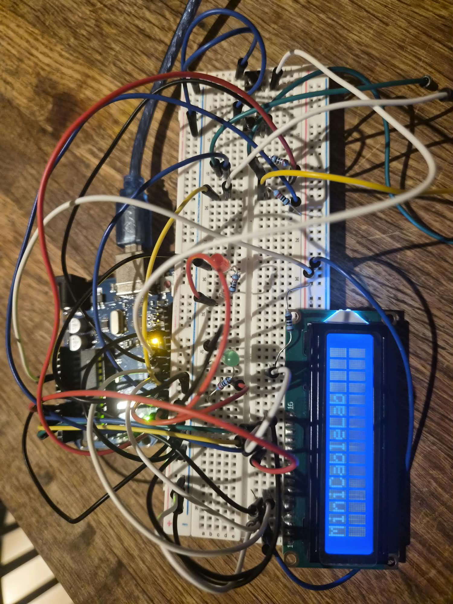
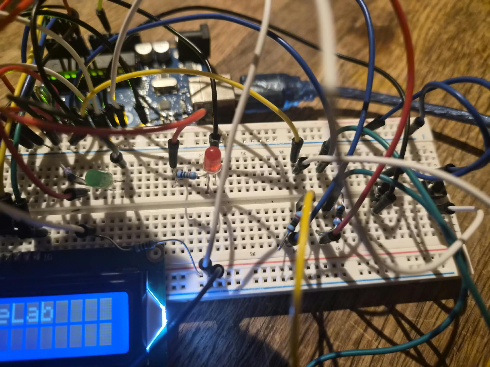
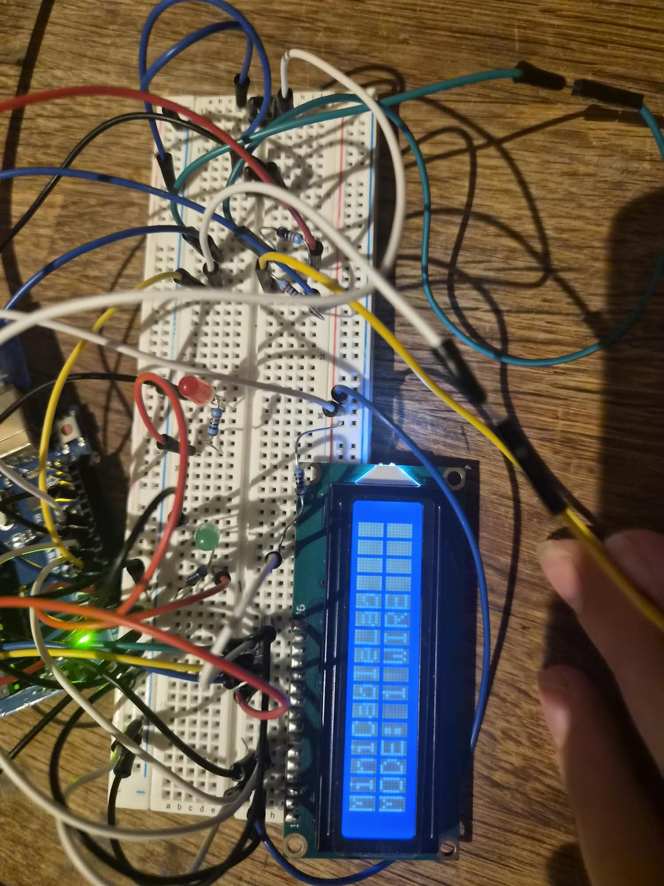
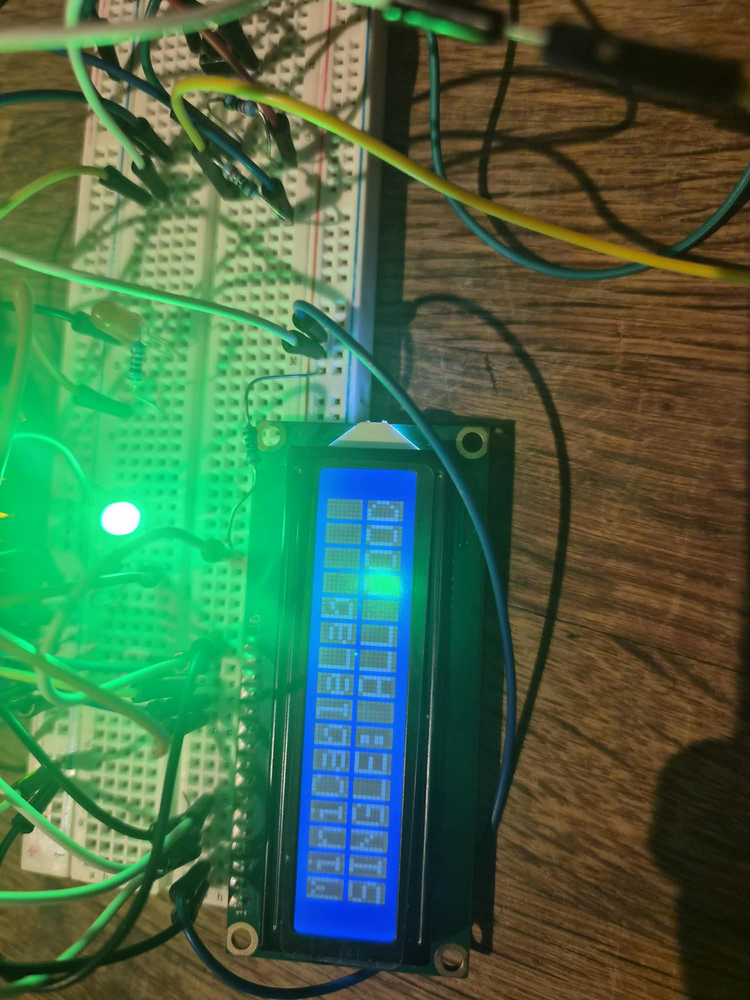
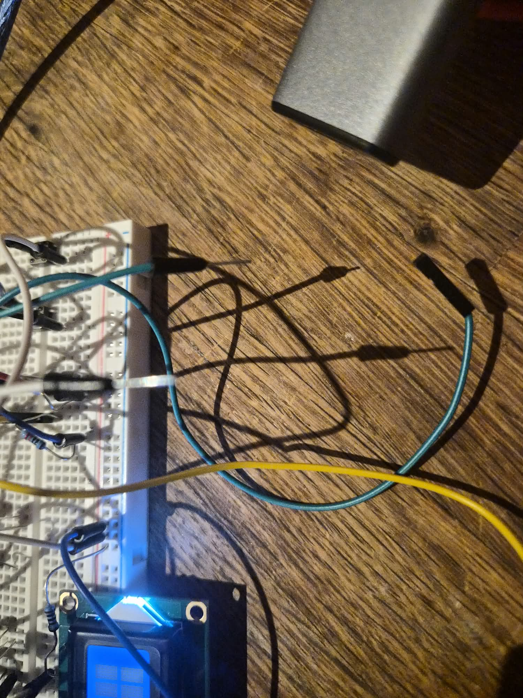
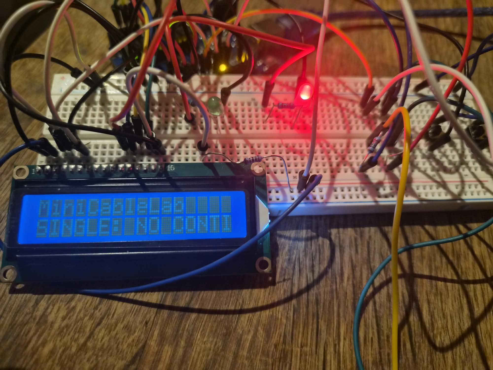

# MiniCableLab

MiniCableLab is a small cable tester I made with an **Arduino Uno**.

The idea is simple: before using a wire in another project, I want to check if it works and see what the problem is if it doesn't.

I started with a basic continuity test. Then I added a **16x2 LCD**, **two LEDs**, and **two buttons** so I can use it without opening the Serial Monitor every time.

> **Important:** This tester is for **disconnected, unpowered wires only**. Never connect it to a powered circuit, a battery, or mains electricity.

## My prototype

Here are three pictures of the actual build.

**1. Full prototype** — Arduino, breadboard, LCD, buttons, and LEDs.



**2. LCD and buttons** — the TEST and MODE buttons with the display.



**3. Wiring and test connectors** — how the wires connect to the test points.


## What it can do

There are two modes:

- **1 WIRE:** check if one wire has continuity.
- **2 WIRES:** check two connections and detect different wiring problems.

The **MODE** button changes the mode. The **TEST** button starts a measurement.

The result stays on the LCD until I change the mode or start another test. A **green LED** means the test passed. A **red LED** means a problem was detected.

## Components

- Arduino Uno
- Breadboard
- LCD 1602 (16 columns, 2 rows)
- 2 push buttons (TEST and MODE)
- 1 green LED and 1 red LED
- 4 resistors of 1 kΩ: 2 for the LEDs and 2 for the test outputs
- A current-limiting resistor for the LCD backlight
- Dupont wires (male-male, male-female, female-female)

## Connections

### Arduino pins

| Pin | Used for |
| --- | --- |
| D2 | First test output, through a 1 kΩ resistor |
| D3 | Second test output, through a 1 kΩ resistor |
| D6 | First test input (`INPUT_PULLUP`) |
| D7 | Second test input (`INPUT_PULLUP`) |
| D5 | Green LED, with its own 1 kΩ resistor |
| D4 | Red LED, with its own 1 kΩ resistor |
| D10 | TEST button (other side connected to GND) |
| D11 | MODE button (other side connected to GND) |

### LCD 1602

| LCD pin | Arduino pin |
| --- | --- |
| VSS | GND |
| VDD | 5V |
| VO | GND (fixed contrast for now) |
| RS | D8 |
| RW | GND |
| E | D9 |
| D4 | A0 |
| D5 | A1 |
| D6 | A2 |
| D7 | A3 |

LCD pins D0 to D3 are not used. The LCD backlight uses `A` and `K`, with a suitable series resistor on `A`.

## How the test works

I use `D2` and `D3` to send a LOW signal, and `D6` and `D7` to read it.

`D6` and `D7` use `INPUT_PULLUP`:

- **HIGH (1):** no LOW signal was detected.
- **LOW (0):** a LOW signal reached the input through an electrical connection.

For two conductors, I test one output at a time, so I can see where each signal goes.

```text
D2 --- 1 kΩ --- [wire to test] --- D6
D3 --- 1 kΩ --- [wire to test] --- D7
```

The wires being tested are removable. There must not be another permanent connection between the test points, or the result would be wrong.

### What the faults mean

- **Open circuit:** the electrical path is interrupted. It could be a broken wire, an unplugged connector, or a bad contact.
- **Inverted connections:** the two wires reach the wrong destinations (`D2 → D7`, `D3 → D6`).
- **Possible short circuit:** a signal reaches points that should be electrically separated, for example if the two conductors touch.

The tester measures electrical connections, not the physical cause of the problem. So `CUT` means *missing continuity*, not necessarily a wire broken inside. A short-circuit message also means a **possible** short or unexpected electrical path.

## How to use it

1. Unplug the Arduino USB cable before changing the test wiring.
2. Connect the **unpowered** wire or wires I want to test.
3. Plug in the Arduino.
4. Press **MODE** to select `1 WIRE` or `2 WIRES`.
5. Press **TEST** to check the connection.
6. Read the LCD message and the status LED.

The TEST button does not turn the device off. It just starts another test.

## Test results and pictures

For each test, I want to show **two real pictures**: the first one shows the wire connections, and the second one shows the LCD message and LED after pressing TEST.

### 01. Single wire — All good

**Mode:** `1 WIRE`  
**Wiring:** Connect one working wire between D2 and D6.  
**LCD:** `SINGLE: ALL GOOD`  
**LED:** Green.  
**Result:** The wire has continuity.

| Wire connections | LCD + status LED |
| :---: | :---: |
|  |  |

### 02. Single wire — Open circuit

**Mode:** `1 WIRE`  
**Wiring:** Leave D2 and D6 disconnected, or use a wire with no continuity.  
**LCD:** `SINGLE: OPEN`  
**LED:** Red.  
**Result:** There is no detected connection between D2 and D6.

| Wire connections | LCD + status LED |
| :---: | :---: |
|  |  |

### 03. Two wires — All good

**Mode:** `2 WIRES`  
**Wiring:** Connect D2 to D6 and D3 to D7.  
**LCD:** `ALL GOOD !`  
**LED:** Green.  
**Result:** Both connections match the expected wiring.

| Wire connections | LCD + status LED |
| :---: | :---: |
|  |  |

### 04. First wire — Open circuit

**Mode:** `2 WIRES`  
**Wiring:** Leave D2 to D6 disconnected, but keep D3 to D7 connected.  
**LCD:** `D2-D6 CUT`  
**LED:** Red.  
**Result:** The first connection has no continuity.

| Wire connections | LCD + status LED |
| :---: | :---: |
|  |  |

### 05. Second wire — Open circuit

**Mode:** `2 WIRES`  
**Wiring:** Keep D2 to D6 connected, but leave D3 to D7 disconnected.  
**LCD:** `D3-D7 CUT`  
**LED:** Red.  
**Result:** The second connection has no continuity.

| Wire connections | LCD + status LED |
| :---: | :---: |
|  |  |

### 06. Both wires — Open circuit

**Mode:** `2 WIRES`  
**Wiring:** Leave both connections disconnected.  
**LCD:** `BOTH CABLES CUT`  
**LED:** Red.  
**Result:** Neither connection has continuity.

| Wire connections | LCD + status LED |
| :---: | :---: |
|  |  |

### 07. Inverted connections

**Mode:** `2 WIRES`  
**Wiring:** Cross the connections: D2 to D7 and D3 to D6.  
**LCD:** `INVERTED CABLE`  
**LED:** Red.  
**Result:** Both wires are connected, but their destinations are swapped.

| Wire connections | LCD + status LED |
| :---: | :---: |
|  |  |

### 08. Possible short circuit

**Mode:** `2 WIRES`  
**Wiring:** With USB unplugged, connect D2 to D6 and D3 to D7, then add one temporary wire between the D6 and D7 test points. Reconnect power and press TEST.  
**LCD:** `SHORT CIRCUIT`  
**LED:** Red.  
**Result:** The two conductors are no longer isolated. This is a simulated short, not a powered 5V-to-GND short.

| Wire connections | LCD + status LED |
| :---: | :---: |
|  |  |

### 09. Other fault (optional)

**Mode:** `2 WIRES`  
**Wiring:** Only add this example if I can reproduce an unexpected connection safely and reliably.  
**LCD:** `OTHER FAULT`  
**LED:** Red.  
**Result:** The readings do not match the predefined cases.

| Wire connections | LCD + status LED |
| :---: | :---: |
|  |  |

## Button demonstration video

Finally, I want to record **one video** showing the two buttons working together: pressing **MODE** to change between `1 WIRE` and `2 WIRES`, then pressing **TEST** to display a result. The video should show the LCD and LEDs clearly.

## Project files

```text
MiniCableLab/
├── README.md
├── MiniCableLab_v1.ino
└── images/
    ├── overview/
    │   ├── 01-full-prototype.jpg
    │   ├── 02-lcd-buttons.jpg
    │   └── 03-wiring.jpg
    └── tests/
        ├── 01-single-ok-wires.jpg
        ├── 01-single-ok-result.jpg
        └── ...                   # Two pictures for every test above
```
## What I learned

This project helped me practice:

- Arduino digital inputs and outputs
- `INPUT_PULLUP`, `HIGH`, and `LOW`
- Continuity tests, open circuits, and short circuits
- Buttons and LCD control
- Testing real wiring problems instead of guessing what went wrong

## Next improvements

- Make the test connectors easier to use and label them properly
- Improve the LCD contrast
- Add the real pictures and button demo video
- Make the code easier to extend
- Test 3, 4 or more conductors later

**Status:** Working breadboard prototype. The two modes, LCD, buttons, and LEDs are working.

