# MiniCableLab

MiniCableLab is a small cable tester I built with an **Arduino Uno**.

The goal is simple: before I use a wire in another project, I want to check if it works and quickly understand what the problem is if it does not.

I started with a basic continuity test, then I added:

- a **16x2 LCD**
- **2 LEDs**
- **2 push buttons**
- a **1-wire mode** and a **2-wire mode**

So now I can use it like a real small tool, not just a breadboard test.

> **Important:** MiniCableLab is only for **disconnected, unpowered wires**. Do **not** connect it to a powered circuit, a battery, or mains electricity.

---

## Project overview

<table>
  <tr>
    <td align="center">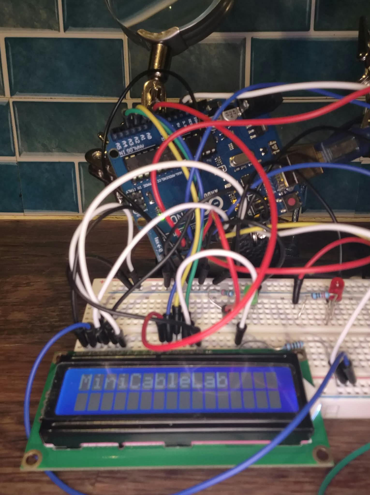 LCD and buttons</td>
    <td align="center">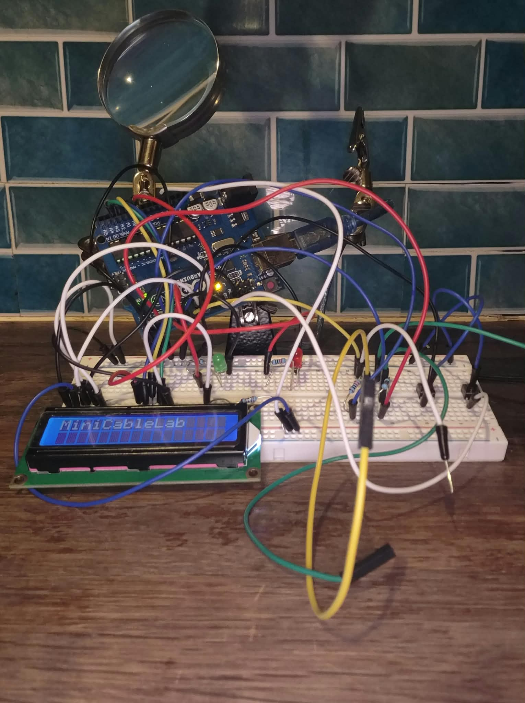 Prototype overview</td>
    <td align="center">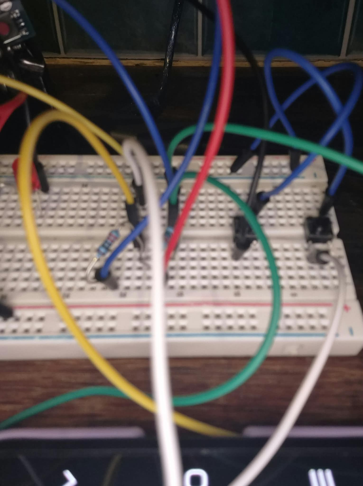 Test wires / connections</td>
    
  </tr>
</table>

---

## What it can do

MiniCableLab has two modes:

- **1 WIRE**: check continuity between **D2** and **D6**
- **2 WIRES**: check two conductors and detect different wiring faults

The **MODE** button changes the mode.

The **TEST** button starts the measurement.

The result is shown on:

- the **LCD**
- the **green LED** if the test is OK
- the **red LED** if a fault is detected

---

## Main components

- Arduino Uno
- Breadboard
- LCD 1602 (16x2)
- 2 push buttons (**TEST** and **MODE**)
- 1 green LED
- 1 red LED
- 4 resistors of 1 kΩ
  - 2 for LED protection
  - 2 for the test outputs
- 1 resistor for LCD backlight
- Dupont wires

---

<h2>Pin Configuration & Circuit Diagram</h2>

<table align="center">
  <tr>
    <th align="center">Circuit Diagram</th>
    <th align="center">Pin</th>
    <th align="center">Function</th>
  </tr>

  <tr>
    <td rowspan="14" align="center" valign="middle">
      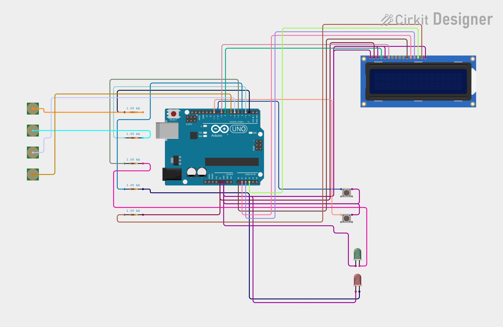
      

        MiniCableLab v1 - Wiring diagram
      

    </td>
    <td align="center">D2</td>
    <td>First test output</td>
  </tr>

  <tr><td align="center">D3</td><td>Second test output</td></tr>
  <tr><td align="center">D6</td><td>First test input</td></tr>
  <tr><td align="center">D7</td><td>Second test input</td></tr>
  <tr><td align="center">D5</td><td>Green LED</td></tr>
  <tr><td align="center">D4</td><td>Red LED</td></tr>
  <tr><td align="center">D10</td><td>TEST button</td></tr>
  <tr><td align="center">D11</td><td>MODE button</td></tr>
  <tr><td align="center">D8</td><td>LCD RS</td></tr>
  <tr><td align="center">D9</td><td>LCD E</td></tr>
  <tr><td align="center">A0</td><td>LCD D4</td></tr>
  <tr><td align="center">A1</td><td>LCD D5</td></tr>
  <tr><td align="center">A2</td><td>LCD D6</td></tr>
  <tr><td align="center">A3</td><td>LCD D7</td></tr>

</table>

<h3>LCD Power</h3>

- VSS → GND
- VDD → 5V
- VO → GND
- RW → GND
- Backlight → Current-limiting resistor

**Notes:**
- D6 and D7 use `INPUT_PULLUP`.
- D2 and D3 use 1 kΩ protection resistors.
- TEST and MODE buttons use `INPUT_PULLUP`.
- Both LEDs use 1 kΩ resistors.

---

## How it works

MiniCableLab sends a **LOW** signal on one output at a time and checks whether that signal reaches the expected input.

The inputs use `INPUT_PULLUP`, so:

- **HIGH** means no LOW signal arrived
- **LOW** means the signal was detected through an electrical path

This lets the program detect:

- correct wiring
- open circuits
- swapped connections
- possible short circuits
- other unexpected cases

---

## Diagnostic visuals

The following visuals explain each test result.

<table>
  <tr>
    <td align="center">
      <h3>01 — Two Wires All Good</h3>
      
Both conductors are correctly connected.

      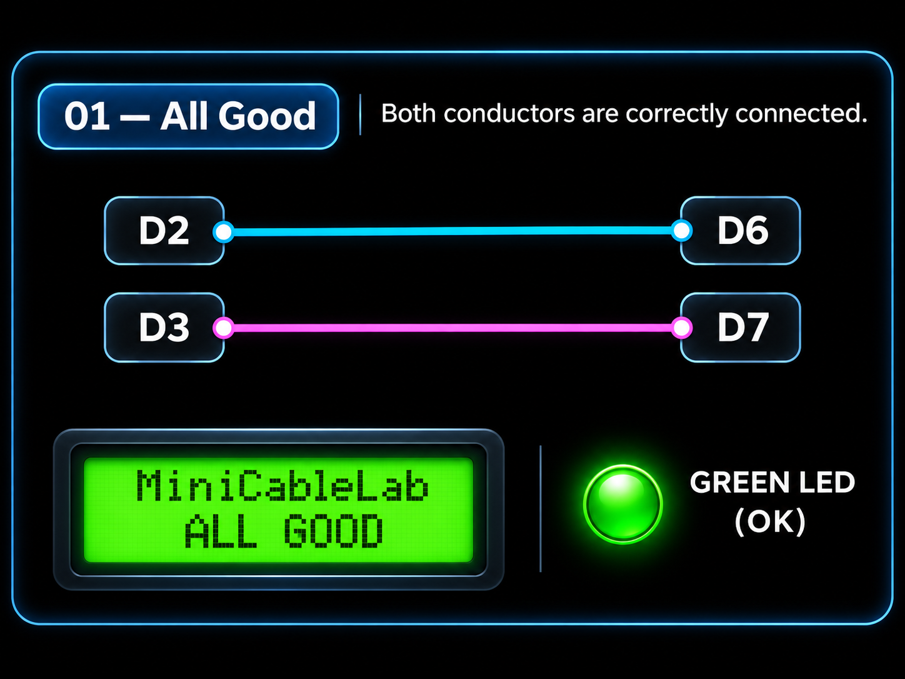
    </td>
    <td align="center">
      <h3>02 — Single Wire OK</h3>
      
The wire has continuity between <b>D2</b> and <b>D6</b>.

      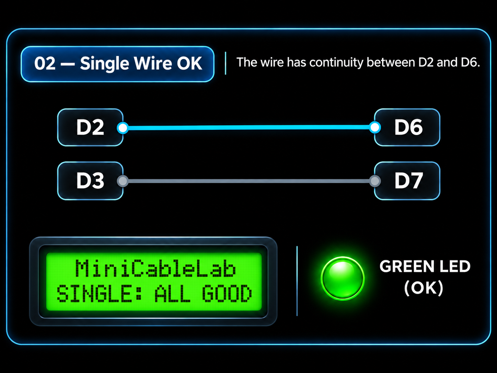
    </td>
  </tr>

  <tr>
    <td align="center">
      <h3>03 — Single Wire Open</h3>
      
No continuity is detected between <b>D2</b> and <b>D6</b>.

      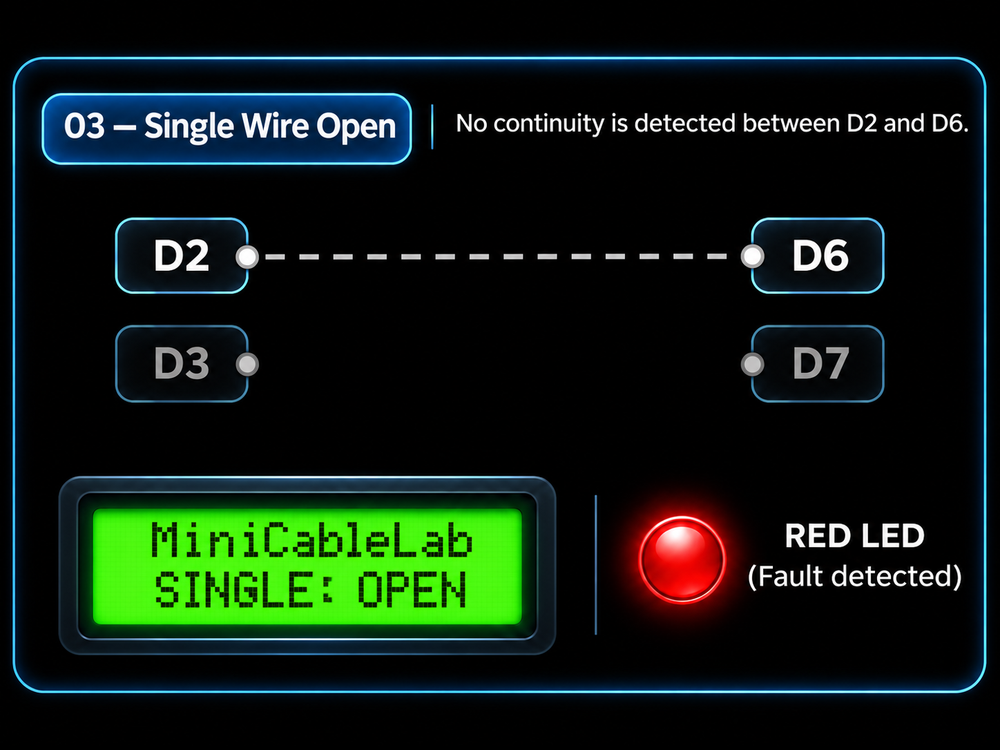
    </td>
    <td align="center">
      <h3>04 — D2-D6 Cut</h3>
      
The connection between <b>D2</b> and <b>D6</b> is open.

      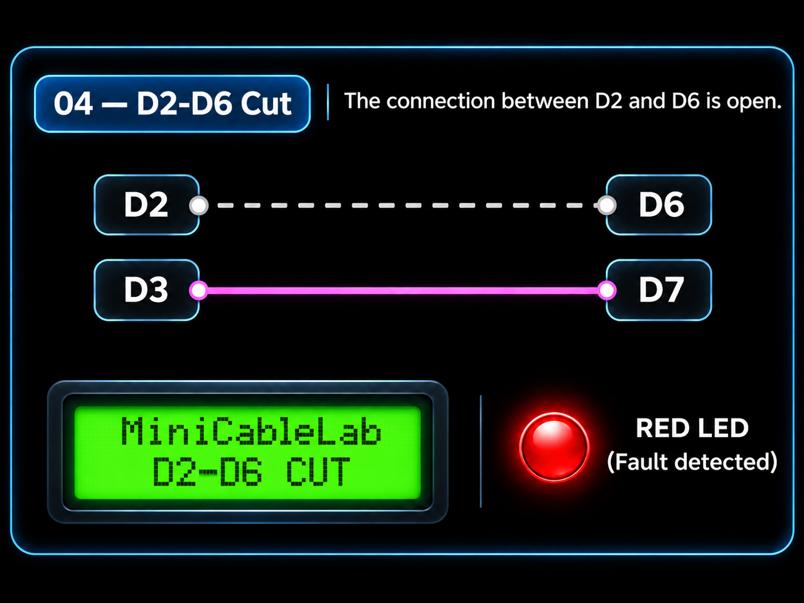
    </td>
  </tr>

  <tr>
    <td align="center">
      <h3>05 — D3-D7 Cut</h3>
      
The connection between <b>D3</b> and <b>D7</b> is open.

      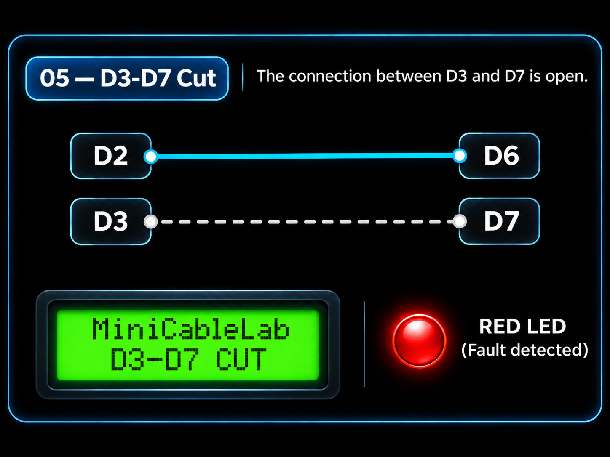
    </td>
    <td align="center">
      <h3>06 — Both Cables Cut</h3>
      
No continuity is detected on either connection.

      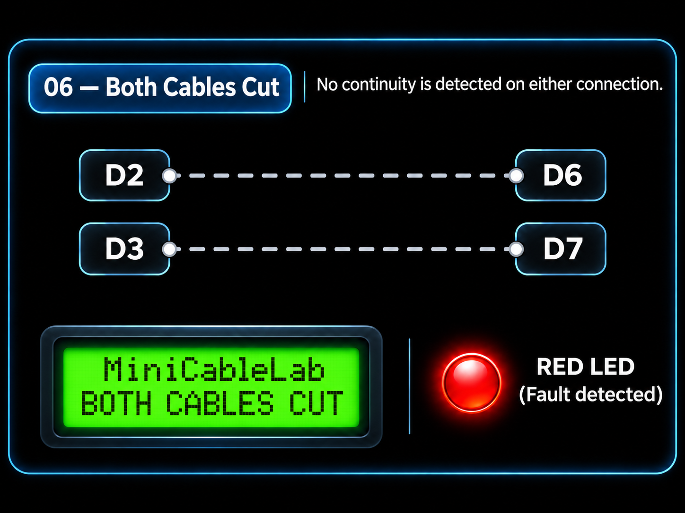
    </td>
  </tr>

  <tr>
    <td align="center">
      <h3>07 — Inverted Connections</h3>
      
The two conductors are connected to the wrong inputs.

      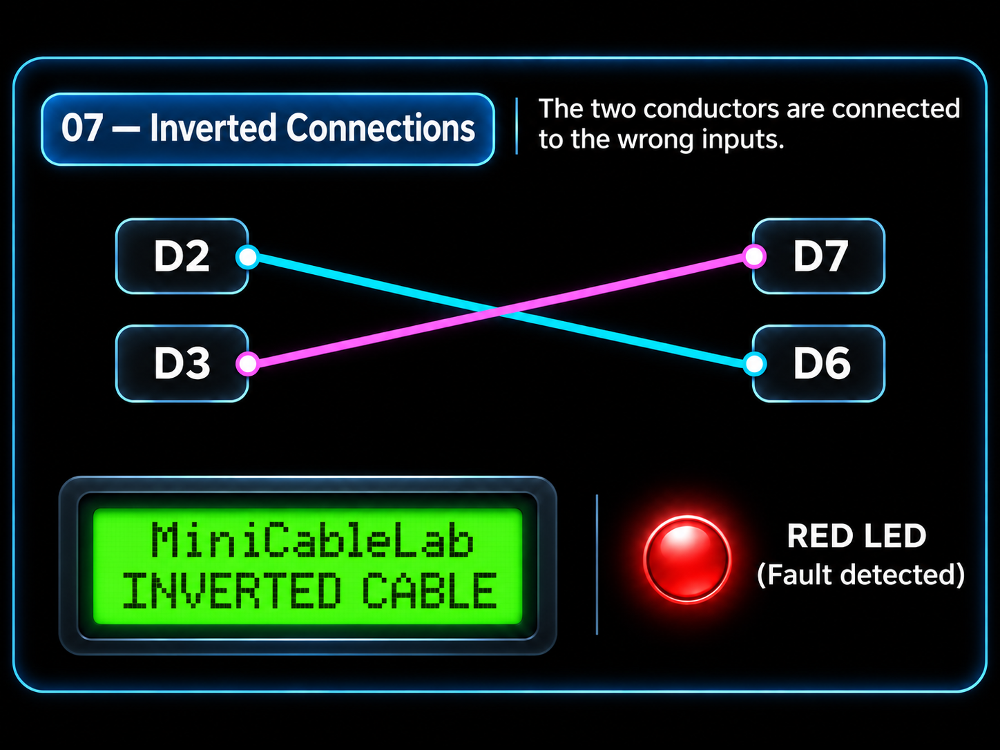
    </td>
    <td align="center">
      <h3>08 — Short Circuit</h3>
      
An unexpected connection is detected between the two conductors.

      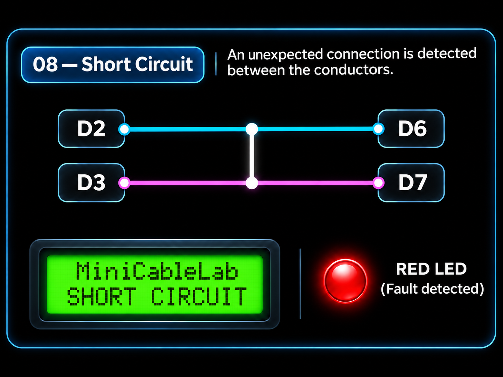
    </td>
  </tr>
</table>

### 09 — Other Fault

The readings do not match the expected cases.

  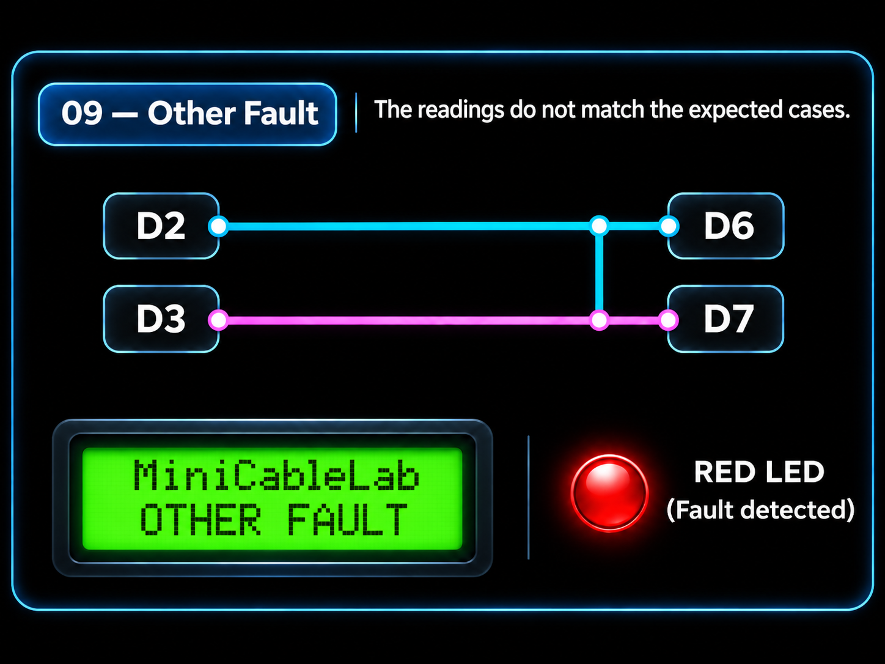

**Important note:** the schematic visuals above were **generated with ChatGPT** based on my project, to make the README cleaner and easier to read.

---

## What I learned

This project helped me practice:

- Arduino digital inputs and outputs
- `INPUT_PULLUP`
- continuity tests
- open circuits and possible short circuits
- LCD display control
- push buttons and mode selection
- turning a breadboard prototype into a usable tool

---

## Next improvements

- make the test connectors cleaner and easier to use
- improve the physical case / presentation
- add support for more conductors later
- improve the LCD contrast if needed
- maybe make a more compact version in the future

---

## Project status

**Current status:** working breadboard prototype.

MiniCableLab can already:

- test **one wire**
- test **two wires**
- display the result on the LCD
- use a **MODE** button and a **TEST** button
- indicate the result with green and red LEDs

---

## Real demo video

- the **MODE** button changing between **1 WIRE** and **2 WIRES**
- the **TEST** button starting a measurement
- the LCD updating the result
- the LEDs changing depending on the result

https://github.com/user-attachments/assets/a015ddea-60a1-42a3-85c5-0ec27cc3e250

